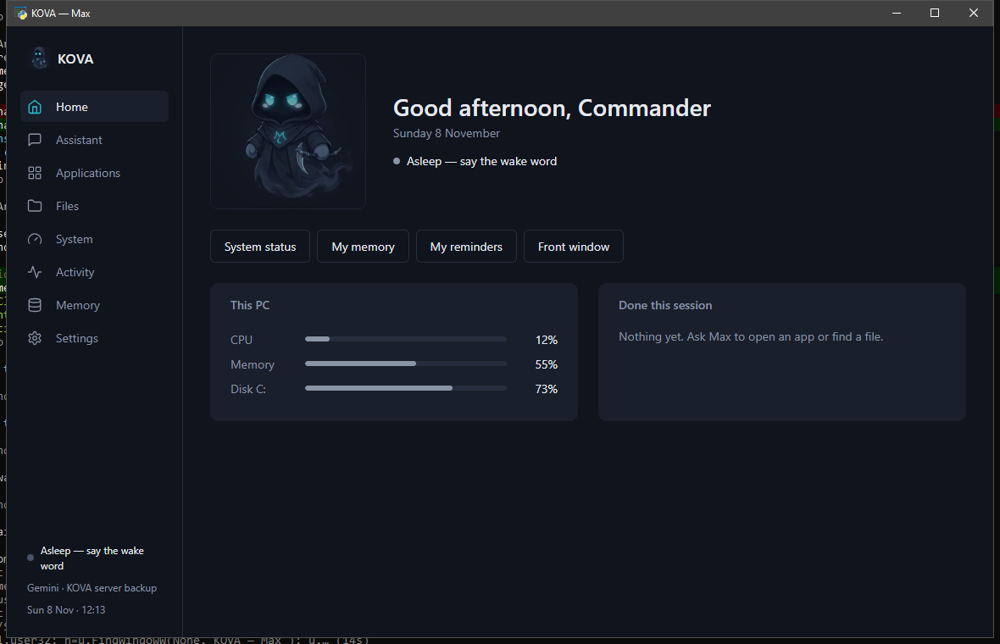

# KOVA



KOVA is Bilal's Windows desktop assistant. Max and Mira can answer with an optional online brain, speak, and operate the desktop through registered tools. Local commands such as opening apps, controlling volume, and checking system status work without API keys.

## Install

Use Python 3.10 or newer in a virtual environment:

```powershell
python -m venv .venv
.\.venv\Scripts\Activate.ps1
pip install -r requirements.txt
```

## Optional AI keys

Copy `config.json.example` to `config.json`. Gemini and OpenRouter keys are both optional. Add either key only to your local `config.json`; never share that file. With no keys, KOVA still runs local commands, and the dashboard welcome screen offers setup.

## Run

```powershell
python main.py --ui
```

For the console experience:

```powershell
python main.py
```

On Windows, `run_max.bat` starts the dashboard without opening a console window.

## Hotkeys

- `Ctrl+Alt+M`: listen (push to talk)
- `Ctrl+Alt+K`: type a command

## Voice commands

Try `help` for the complete list. Examples taken from the local command table include:

- `open <app or website>`, `open my downloads`, `open a new tab`
- `close <app>`, `force close <app>`, `restart <app>`
- `play <song>`, `pause / resume`, `volume up / down`, `mute / unmute`
- `what's on my screen`, `what can I click here`, `click <button name>`
- `what time is it`, `battery`, `check my internet speed`
- `remember <something about you>`, `remind me in 10 minutes to <something>`, `undo`

## Quick demo

Start KOVA with `run_max.bat`, then try `what time is it`, `which apps are running`, and `what is my RAM usage`. These use local tools and do not need an AI key. For a visible desktop action, say `open calculator`; close it yourself when you are done. For screen reading, ask `what is on my screen` and review the screenshot approval before it is sent to the configured AI.

## Safety

Every desktop action runs through a registered tool and the ActionRunner. Tool permissions are checked, risky actions ask first, and completed actions are logged. Normal app close is gentle and allows the app to ask about unsaved work; force close asks because it can lose work. Max reports completion only when the tool reports success. KOVA does not run shell commands from Max.

## Logs

Logs are stored in the repository's `logs/` directory. Action history is in `logs/actions.jsonl`; application diagnostics are in `logs/kova.log`. Keep local configuration files private.
